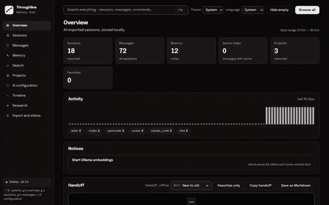
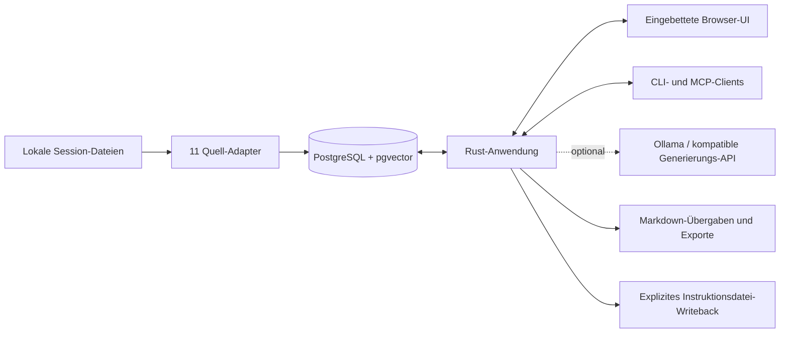

<p align="center">
  <picture>
    <source media="(prefers-color-scheme: dark)" srcset="docs/brand/throughline-wordmark-dark.svg">
    
  </picture>
</p>

<p align="center"><strong>Deine Werkzeuge wechseln. Dein Projektkontext darf nicht verschwinden.</strong></p>
<p align="center">Eine selbst gehostete Gedächtnisschicht für KI-Coding-Sessions. Rust-Kern, PostgreSQL, Deine Maschine.</p>

<p align="center">
  <a href="https://github.com/mkupermann/throughline/actions/workflows/ci.yml"></a>
  <a href="LICENSE"></a>
  <a href="rust/Cargo.toml"></a>
  <a href="sql/schema.sql"></a>
  <a href="CHANGELOG.md"></a>
</p>

<p align="center"><a href="README.md">English</a> · <strong>Deutsch</strong></p>

Jedes KI-Coding-Tool speichert seine eigenen Session-Dateien und vergisst den Rest. Entscheidungen verschwinden in Transkripten. Korrekturen werden neu erfunden. Kontext wird wieder und wieder erklärt. Throughline importiert diese lokalen Sessions in eine durchsuchbare PostgreSQL-Historie. Du findest eine Entscheidung wieder, prüfst die Original-Nachrichten samt Tool-Aufrufen und nimmst eine quellenverknüpfte Übergabe in die nächste Session mit. Auch beim Werkzeugwechsel.

**Importieren. Prüfen. Merken. Weitermachen.** Stöbern, Stichwortsuche und Übergabe-Briefings funktionieren ohne Modell. Optionale lokale Modelle ergänzen Embeddings, Memory-Extraktion und Antworten mit Quellenangabe.

[Demo starten](#die-demo-mit-fiktiven-daten) · [Installation](#eigene-sessions-nutzen) · [Produkt-Tour](#die-produkt-tour) · [CLI und MCP](#jenseits-des-browsers) · [Architektur](#wie-es-zusammenspielt) · [Grenzen](#aktuelle-grenzen)

[](docs/media/rust/tour.mp4)

*Echte Anwendung, fiktive Daten, keine gefälschten API-Antworten. [Ganze Tour als Video (MP4)](docs/media/rust/tour.mp4) · [Capture-Manifest](docs/media/rust/manifest.json).*

> **Welche Version ist das?** Das Standard-Docker-Compose baut die Rust-Anwendung mit eingebetteter Browser-Oberfläche. Das Repository enthält zusätzlich eine ältere Python/FastAPI + React-Anwendung. Deren Team-Operations, Template-Bibliothek und Konten-Verwaltung sind keine Funktionen der Rust-Oberfläche. Dieses README beschreibt den Rust-Standardpfad.

## Warum Throughline?

| Wenn Du das brauchst… | …liefert Throughline |
| --- | --- |
| Ein Projekt nach einer Pause wieder aufnehmen | Letzte Sessions, dauerhafte Notizen und ein Offline-Übergabe-Briefing. |
| Verstehen, warum eine Entscheidung fiel | Suchtreffer mit Verbindung zur Original-Konversation. |
| Zwischen Coding-Tools wechseln | Einen gemeinsamen Speicher, Markdown-Export und MCP-Zugriff. |
| Prüfen, was ein Agent aufgezeichnet hat | Nachrichteninhalt, Tool-Call-JSON, Zeitstempel und Quell-Tool-Label. |
| Angesammelten Kontext pflegen | Memory-Kategorien, Deduplizierung, Stale-Memory-Berichte und explizites Writeback. |

### Unterstützte Session-Quellen

Die Rust-Registry enthält **11 Adapter**: Claude Code, Codex, Cursor, Zed, Continue, Cline, Windsurf, Vibe, Hermes, OpenCode und Aider. Sie lesen unterstützte lokale Dateien. Es sind keine Cloud-Synchronisierungen, und die Format-Abdeckung ist je Tool unterschiedlich.

Das Standard-Compose mountet die ersten neun Tool-Verzeichnisse schreibgeschützt. OpenCode und Aider brauchen ihre Quellverzeichnisse separat. Quelle der Wahrheit ist die [Adapter-Registry](rust/crates/throughline/src/adapters/registry.rs).

## Die Demo mit fiktiven Daten

Drei Befehle. Kein Modell-Download, kein API-Schlüssel. Du brauchst Git und Docker mit Compose.

```bash
git clone https://github.com/mkupermann/throughline.git
cd throughline
docker compose -f docs/demo/rust/compose.yml up -d --build
```

Öffne **[http://127.0.0.1:8796](http://127.0.0.1:8796)**.

Die Demo hat eine eigene Datenbank und ein eigenes Volume. Sie veröffentlicht nur den Web-Port auf Loopback und mountet keine persönlichen Session-Ordner. Ihr öffentliches Passwort gilt nur für diesen Wegwerf-Stack. Die Modell-Endpunkte zeigen absichtlich auf eine nicht erreichbare Loopback-Adresse.

| Demo-Projekt | Geschichte zum Erkunden |
| --- | --- |
| **Atlas-demo** | Lexikalische Suche als Baseline behalten. Ein Gegenbeispiel bei langen Dokumenten untersuchen. |
| **Harbor-demo** | Tastatur-Navigation und sichtbaren Fokus erhalten. Eine Release-Übergabe vorbereiten. |
| **Orchard-demo** | Datenverträge validieren. Die Erholung nach einem abgebrochenen Ladevorgang proben. |

Die Fixture enthält **18 Konversationen, 72 Nachrichten, 12 Memory-Notizen und drei Projekte** über sechs Quell-Tool-Label. Entscheidungen, Tool-Ergebnisse und Modellnamen sind erfunden. Die Daten werden beim Seed zeitlich neu verankert. Das ist kein Benchmark-Beleg und keine abgeschlossene Agenten-Arbeit.

1. Öffne **Projects → Atlas-demo**, dann eine Konversation, und klappe die Nachrichten auf.
2. Prüfe das fiktive `Read`-Tool-Ergebnis über **Browse**.
3. Wähle in **Find** den Modus **Lexical** und suche nach `decision`.
4. Filtere in **Agent Memory** die Kategorie `decision`.
5. Schalte **Timeline** auf **Calendar** um und geh zurück auf **Home** zur Übergabe.
6. Öffne **Operate → Status** und prüfe die Korpus-Summen.

Stoppen mit `docker compose -f docs/demo/rust/compose.yml stop`. Der [Demo-Leitfaden](docs/demo/rust/README.md) erklärt Neu-Seeden, Screenshots und Aufräumen.

## Eigene Sessions nutzen

Du brauchst Git, Python 3 für den Umgebungs-Initialisierer und Docker mit Compose. Die Anwendung selbst läuft als Rust im Container.

```bash
git clone https://github.com/mkupermann/throughline.git
cd throughline
python3 scripts/init_compose_env.py --check-docker
docker compose up -d --build
docker compose exec web throughline ingest --source all
docker compose exec web throughline doctor
```

Öffne **[http://127.0.0.1:8788](http://127.0.0.1:8788)**. Unter Windows nimm `py -3`, falls `python3` fehlt.

Der Initialisierer erzeugt eine ignorierte `.env` mit zufälligem Datenbank-Passwort und löst den Cline-Mount auf. Die Quellpfade stehen in [docker-compose.yml](docker-compose.yml). Der Import ist explizit. Unveränderte Datei-Hashes werden beim nächsten Lauf übersprungen. Eine neue `.env` rotiert keine Zugangsdaten in einem bestehenden Datenbank-Volume.

### Sichern, aktualisieren und exportieren

Sichere immer mit explizitem Ziel in das gemountete Backup-Volume:

```bash
docker compose exec web throughline backup --dir /var/lib/throughline/backups
git pull
docker compose build web migrate
docker compose up -d migrate web
docker compose exec web throughline doctor
```

Rust liest `THROUGHLINE_BACKUP_DIR`, nicht die ältere Variable `CLAUDE_MEMORY_BACKUP_DIR` im Compose. Das explizite `--dir` hält das Backup aus der Wegwerf-Schicht des Containers heraus. Halte Kopien außerhalb des Hosts vor und prüfe die Wiederherstellung.

```bash
docker compose exec web throughline export-markdown --out /home/throughline/exports
```

Exporte landen im gemounteten `./exports`, solange Du `THROUGHLINE_EXPORT_DIR` nicht änderst. Optionen sind unter anderem `--project`, `--include-generated` und `--redact`. Prüfe einen Export, bevor Du ihn teilst. Die Schwärzung senkt das Risiko, sie garantiert keine Anonymisierung.

**`docker compose down -v` löscht die Daten-Volumes. Auf einer echten Installation nur ausführen, wenn genau das beabsichtigt ist.**

## Die Produkt-Tour

Alle neun Menüs und ihre Nebenansichten sind unten abgebildet, aufgenommen aus der laufenden Demo. Der [visuelle Funktionsleitfaden](docs/FEATURE_GUIDE.md) zeigt zusätzlich Alternativ-Ansichten, Detailseiten, jede Wartungsaktion und die CLI.

| Menü | Zweck | Kürzel |
| --- | --- | --- |
| Home | Summen, Aktivität, Hinweise, Übergabe und letzte Sessions. | `g h` |
| History | Konversationen filtern, sortieren, blättern, exportieren. | `g s` |
| Browse | Nachrichten und Tool-Aufrufe durchsuchen. | `g b` |
| Agent Memory | Dauerhafte Notizen nach Kategorie prüfen. | `g m` |
| Find | Lexikalische, semantische und hybride Suche. | `g f` |
| Projects | Die gefilterte Historie eines Projekts öffnen. | `g j` |
| Timeline | Aktivität nach Datum und Quell-Tool. | `g t` |
| Ask | Antworten mit Quellenangaben. | `g a` |
| Operate | Wartung und Ingestion-Status. | `g p` |

`Ctrl+K` / `Cmd+K` öffnet die Befehls-Palette. Ein Kürzel heißt: erst `g`, dann die zweite Taste.

### Home. Den Faden wieder aufnehmen

Klick auf eine Kennzahl und steig in den Korpus ein. Prüfe Aktivität, letzte Sessions und das Offline-Briefing. **Hide empty** räumt die Session-Liste auf, **Browse all** öffnet die Nachrichten. Die modellfreie Demo meldet das fehlende Ollama sichtbar in den Hinweisen. Nichts wird versteckt.


### History. Konversationen im Zusammenhang

Filtere nach Text, Tool, Projekt und Datum. Sortiere, wechsle zwischen Tabelle und Karten, speichere Filter, blättere oder exportiere CSV. Öffne eine Session und lies ihre Nachrichten mit Rollen.


### Browse. Die Nachrichten darunter prüfen

Filtere nach Text, Rolle, Tool-Name oder Konversations-ID, oder wähle **Tool calls only**. Eine Nachricht öffnet den vollen Inhalt, das Tool-Call-JSON und die Content-Blöcke, mit **Copy JSON** und **Open session**.


### Agent Memory. Dauerhaften Kontext griffbereit halten

Durchsuche Notizen, filtere Kategorien und klappe Karten auf. **Ingest agent memory** liest lokale Markdown-Memory-Dateien. `THROUGHLINE_AGENT_MEMORY_DIR` bestimmt deren Ort. Die Kategorien decken Entscheidungen, Präferenzen, Muster, Erkenntnisse, Fehlerlösungen, Projektkontext und Workflows ab.


### Find. Über alle Tools hinweg suchen

Wähle **Lexical**, **Semantic** oder **Hybrid**. Die lexikalische Suche braucht kein Modell. Die semantische Suche braucht gespeicherte Embeddings und einen passenden Embedding-Dienst. Treffer verlinken auf Konversationen und nennen das Such-Backend. Scores sind Retrieval-Werte, keine Wahrheits-Wahrscheinlichkeiten.


### Projects. Über den Arbeitsbereich einsteigen

Karten zeigen die aufgezeichnete Beschreibung, den Status und die Konversations-Anzahl. Eine Auswahl öffnet die Projekt-Historie. Aufgezeichneter Stand ist Historie, keine Prüfung des heutigen Repositories.


### Timeline. Aktivität über die Zeit verfolgen

Prüfe das tägliche Konversations-Volumen, filtere nach Anbieter, wechsle in den Kalender, navigiere durch Monate oder spring zurück auf heute. Chronologie ist keine Kausalität, und die Ansicht hält diesen Unterschied sichtbar.


### Ask. Die aufgezeichnete Evidenz befragen

Stelle eine Frage und folge den gelieferten Quellen. Ein konfiguriertes Generierungs-Backend ist Voraussetzung. Nach der Backend-Auflösung kann ein Generierungsfehler noch Auszüge liefern. Ein nicht auflösbares Backend liefert stattdessen einen Fehler. Der Screenshot zeigt den Eingabe-Zustand, keine erfundene Antwort.


### Operate. Den Speicher pflegen

Starte Ingestion, Status, Embedding, Deduplizierung, Backup, Audit, Stale-Memory-Bericht, Instruktionsdatei-Writeback oder Antwort-Evaluierung. Einige Aktionen verändern Daten oder Dateien, und modellabhängige Aktionen brauchen vorher Konfiguration. Siehe die [Aktions-Referenz](docs/FEATURE_GUIDE.md#maintenance-actions).


### Befehls-Palette

Spring zwischen Ansichten, suche Sessions oder wähle eine Aktion, ohne die Tastatur zu verlassen.


## Jenseits des Browsers

### CLI-Funktionen

Nutze `throughline --help` und `throughline <befehl> --help` für die Optionen. Im Compose stellst Du `docker compose exec web` voran.

```bash
throughline ingest --source codex
throughline search "decision" --limit 10
throughline handoff --project Atlas-demo
throughline decisions --project Atlas-demo
throughline export-markdown --out ./exports --project Atlas-demo
```

| Bereich | Befehle |
| --- | --- |
| Einrichtung und Gesundheit | `migrate`, `serve`, `status`, `doctor` |
| Import und Abruf | `ingest`, `search`, `ask`, `handoff` |
| Anreicherung | `extract-memory`, `embed`, `generate-titles`, `extract-entities` |
| Prüfen und pflegen | `decisions`, `costs`, `audit`, `conflicts`, `reflect`, `stale-digest`, `answer-eval` |
| Kontext weitertragen | `scan-instructions`, `writeback`, `export-markdown` |
| Schützen und integrieren | `backup`, `mcp` |

Die [Funktions-Referenz](docs/FEATURE_GUIDE.md#cli-functions) nennt Abhängigkeiten und Nebenwirkungen. Verfügbarkeit heißt nicht, dass jeder Befehl gegen jede Schema-Variante getestet wurde.

### MCP

Starte `throughline mcp` aus einem kompatiblen Client über stdio, mit den Datenbank-Variablen in dessen Prozess-Umgebung. Das Container-Pendant ist `docker compose run -i --rm mcp`.

Der Rust-Server bietet `search`, `list_projects`, `stats`, `write` und `forget` an. Alle fünf Aktionen laufen gegen ein frisches Schema. Der ältere Python-MCP-Server hat einen anderen Tool-Vertrag.

### Optionale Modelle

Setze diese Variablen in der Umgebung des Anwendungs-Containers. Compose braucht einen `environment`-Eintrag oder eine Override-Datei für Variablen, die es nicht ohnehin weiterreicht.

| Zweck | Rust-Einstellungen |
| --- | --- |
| Datenbank | `PGHOST`, `PGPORT`, `PGDATABASE`, `PGUSER`, `PGPASSWORD` |
| Ollama-Endpunkt | `OLLAMA_HOST`, z. B. `http://host.docker.internal:11434` auf Docker Desktop |
| Embeddings | `THROUGHLINE_EMBED_BACKEND=ollama`, `OLLAMA_EMBED_MODEL=nomic-embed-text` (der aktuelle Pfad erwartet 768 Dimensionen) |
| Ollama-Generierung | `THROUGHLINE_ANSWER_BACKEND=ollama`, `THROUGHLINE_ANSWER_MODEL=<installiertes-Modell>` |
| Kompatible Generierung | `THROUGHLINE_ANSWER_BACKEND=compatible`, `THROUGHLINE_ANSWER_BASE_URL`, `THROUGHLINE_ANSWER_MODEL`, optional `THROUGHLINE_ANSWER_API_KEY` |
| Backup-Verzeichnis | `THROUGHLINE_BACKUP_DIR` oder CLI `backup --dir` |

Die Rust-Implementierung unterstützt Ollama und einen explizit konfigurierten OpenAI-kompatiblen Generierungs-Endpunkt. Gehostetes OpenAI als benannter Modus ist deaktiviert, und Embeddings laufen über einen Ollama-kompatiblen Dienst. Ein entfernter Endpunkt erhält die Inhalte, die Du ihm schickst. Details stehen in den Quellen zu [Generierung](rust/crates/throughline/src/llm.rs) und [Embedding](rust/crates/throughline/src/embedding.rs).

## Wie es zusammenspielt



Der Container bettet `rust/crates/throughline/web/index.html` ein. Node ist für den Betrieb nicht nötig. Compose wendet Migrationen an, bevor der Web-Dienst startet. Quelldateien, der PostgreSQL-Speicher und exportiertes Markdown bleiben getrennte Artefakte.

## Nachvollziehbarkeit als Bauprinzip

Regulierer, Prüfer und Forschungseinrichtungen verlangen zunehmend dasselbe: KI-gestützte Arbeit muss im Nachhinein rekonstruierbar sein. Throughline zeichnet KI-Coding-Arbeit genau in der Form auf, die diese Rahmenwerke beschreiben. Das ist eine Design-Aussage, keine Compliance-Zertifizierung.

| Anforderung | Quelle | Was Throughline speichert |
| --- | --- | --- |
| Automatische Aufzeichnung von Ereignissen über die Lebensdauer des Systems, für Nachvollziehbarkeit | [EU AI Act, Art. 12(1) und 12(2)](https://ai-act-service-desk.ec.europa.eu/en/ai-act/article-12), Verordnung (EU) 2024/1689 | Jede importierte Session wird automatisch erfasst, mit Zeitstempeln, Quell-Tool und Modell-Label. Keine manuelle Buchführung. |
| Log-Aufbewahrung von mindestens sechs Monaten durch den Betreiber | [EU AI Act, Art. 19 und Art. 26(6)](https://artificialintelligenceact.eu/article/19/) | Der Korpus liegt im eigenen PostgreSQL-Volume, so lange Du ihn behältst, mit `backup` und Restore als expliziten Befehlen. Löschen ist eine bewusste Handlung. |
| Ein Prüfer muss sehen, welches Modell lief, wie es angewiesen wurde und wie das Ergebnis validiert wurde | [Weltbank-Leitlinien zur KI-Reproduzierbarkeit](https://worldbank.github.io/wb-reproducible-research-repository/guidance/AI_reproducibility_guidelines.html) | Je Nachricht: Modell-Label, vollständiger Prompt- und Antworttext, Rolle, Zeitstempel. Je Antwort in Ask: die zitierten Quelldatensätze. |
| Protokoll je Interaktion mit Zeitstempel, Modellversion, Prompts, Tool-Aufrufen und Ergebnissen für agentengestützte Forschung | [Logging-Schema aus arXiv:2604.00945](https://arxiv.org/pdf/2604.00945) | Der Nachrichtendatensatz enthält genau diese Felder, samt Tool-Call-JSON und Content-Blöcken, prüfbar in Browse. |
| Standardisierte Trace-Attribute für GenAI-Operationen | [OpenTelemetry-GenAI-Konventionen](https://opentelemetry.io/docs/specs/semconv/gen-ai/) | Die gespeicherten Felder lassen sich auf diese Konventionen abbilden. Ein nativer OTel-Export steht auf der Roadmap und ist nicht ausgeliefert. |

Zwei ehrliche Grenzen. Erstens: Throughline zeichnet auf, was die Quell-Tools auf die Platte schreiben. Die Vollständigkeit hängt an deren Session-Formaten. Zweitens: Ob ein konkretes System unter den AI Act fällt, ist eine Rechtsfrage zu diesem System. Diese Software beantwortet sie nicht und behauptet für nichts eine Hochrisiko-Konformität. Was sie liefert, ist das Rohmaterial, das alle diese Rahmenwerke verlangen: die Originalevidenz, lokal gehalten, durchsuchbar, mit intaktem Kontext.

Verwaltungen auf dem Weg zur digitalen Souveränität, etwa die [deutsch-französische Initiative für einen quelloffenen Verwaltungsarbeitsplatz](https://www.dbb.de/artikel-dbb-europathemen/silberbach-begruesst-deutsch-franzoesische-initiative.html), nennen genau die Eigenschaften, auf denen dieses Projekt aufbaut: quelloffen, lokaler Betrieb, keine Anbieterbindung.

## Aktuelle Grenzen

Ehrliche Grenzen sind besser als stille Überraschungen. Das sind die aktuellen.

- **Lokaler, vertrauenswürdiger Betrieb.** Der Rust-Router hat keinen Anwendungs-Login und keine Rollenprüfung. Lass ihn auf Loopback. Ältere Python-Team-Einstellungen schützen diese Laufzeit nicht.
- **Historische Evidenz.** Konversationen, Notizen und Antworten können unvollständig, veraltet oder falsch sein. Ein Tool-Call-Eintrag beweist nicht, dass ein Befehl gelang oder eine Datei noch existiert.
- **Modell-Validierung ist getrennt.** Die Demo zeigt Navigation und ausgewählte deterministische Aktionen, nicht Modellqualität, Vektor-Retrieval, Agenten-Ausführung oder Backup-Wiederherstellung.
- **Unvollständige Parität.** React-Team-Operations, die Template-Bibliothek, Review, SQL-Konsole und Konten-Verwaltung registriert der Rust-Server nicht. Ältere Dokumentation kann andere Befehle und Variablen verwenden.
- **Begrenzte Evaluierung.** Die Antwort-Evaluierung prüft Zitate und konfigurierte Phrasen. Ihre Quote ist kein allgemeines Maß für faktische Richtigkeit. Die Entitäten-Extraktion nutzt Token-Heuristiken.

Der [Verifikationsnachweis](docs/demo/rust/VERIFICATION.md) listet Belege und offene Lücken. Sicherheitsmeldungen laufen über [Security](SECURITY.md).

## Entwickeln und beitragen

Die Standard-Laufzeit liegt in [`rust/`](rust/). Nutze eine zum Lockfile passende Toolchain. Der Container pinnt Rust 1.90.

```bash
cargo build --release --manifest-path rust/Cargo.toml -p throughline
cargo test --manifest-path rust/Cargo.toml -p throughline --lib
```

Integrationstests brauchen eine Wegwerf-PostgreSQL-Datenbank mit pgvector. Screenshot- und Aufnahme-Werkzeuge liegen unter `web/`. Das macht React nicht zur Standard-Oberfläche.

| Weiterlesen | Inhalt |
| --- | --- |
| [Visueller Funktionsleitfaden](docs/FEATURE_GUIDE.md) | Alle Menüs, Detailansichten, Wartungsaktionen und CLI-Funktionen. |
| [Rust-Demo-Leitfaden](docs/demo/rust/README.md) | Isolierte Fixture, Screenshot-Erneuerung und Aufräumen. |
| [Verifikationsnachweis](docs/demo/rust/VERIFICATION.md) | Was geprüft wurde und was offen bleibt. |
| [Contributing](CONTRIBUTING.md) | Konventionen, und wie sich Rust-Arbeit von Python/React-Prüfungen unterscheidet. |
| [Changelog](CHANGELOG.md) | Dokumentierte Projektänderungen. |
| [Frühere Python/React-Demo](docs/DEMO.md) | Fixture und Aufnahmen der Vorgänger-Anwendung. |

Reproduzierbare Fehler melde über [GitHub Issues](https://github.com/mkupermann/throughline/issues). Beiträge folgen dem [Code of Conduct](CODE_OF_CONDUCT.md).

## Lizenz

[MIT](LICENSE). Selbst hosten, selbst prüfen, selbst anpassen.

Deine KI-Arbeit soll sich verzinsen. Nicht verdunsten.
