<p align="center">
  <picture>
    <source media="(prefers-color-scheme: dark)" srcset="docs/brand/throughline-wordmark-dark.svg">
    
  </picture>
</p>

<p align="center"><strong>Your tools change. Your project context should not disappear.</strong></p>
<p align="center">A self-hosted memory layer for AI coding sessions.</p>
<p align="center"><a href="LICENSE">MIT</a> · <a href="rust/Cargo.toml">Rust</a> · <a href="docker-compose.yml">PostgreSQL + pgvector</a> · Beta</p>

Throughline brings local AI conversations into one searchable history. Recover a decision, inspect the original messages and tool calls, and carry a source-linked handoff into your next session—even when you switch coding tools.

**Import → inspect → remember → continue.** Browsing, keyword search and handoff briefs work without a generation model. Optional models add embeddings, memory extraction and cited answers.

[Try the demo](#try-it-with-fictional-data) · [Install](#use-your-own-sessions) · [Product tour](#the-product-tour) · [CLI and MCP](#beyond-the-browser) · [Architecture](#how-it-fits-together) · [Limits](#current-boundaries)

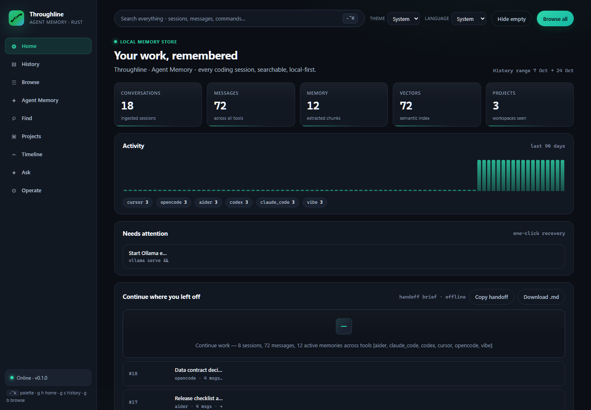

*Actual application, fictional data. All screenshots use the same isolated database; no API responses are mocked. [Capture manifest](docs/media/rust/manifest.json).*

> **Which version is this?** Default Docker Compose builds the Rust application and its embedded HTML/CSS/JavaScript interface. The repository also contains an earlier Python/FastAPI + React application. Its AI team operations, template library and account-management screens are **not features of the current Rust UI**. This README documents the default Rust path.

## Why use Throughline?

| When you need to… | Throughline gives you… |
| --- | --- |
| Resume a project after time away | Recent sessions, durable notes and an offline handoff brief. |
| Understand why a decision was made | Search results connected to the original conversation. |
| Move between coding tools | A shared store, Markdown export and MCP access. |
| Inspect what an agent recorded | Message content, tool-call JSON, timestamps and source-tool labels. |
| Maintain accumulated context | Memory categories, deduplication, stale-memory reports and explicit writeback. |

### Supported session sources

The Rust registry includes **11 adapters**: Claude Code, Codex, Cursor, Zed, Continue, Cline, Windsurf, Vibe, Hermes, OpenCode and Aider. They read supported local files; they are not cloud-account sync integrations. Format coverage varies by tool.

Standard Compose mounts the first nine tool directories read-only. OpenCode and Aider require their source directories to be made available separately. See the [adapter registry and implementations](rust/crates/throughline/src/adapters/registry.rs).

## Try it with fictional data

Install Git and Docker with Compose. The first run builds the Rust image; no model download or API key is required.

```bash
git clone https://github.com/mkupermann/throughline.git
cd throughline
docker compose -f docs/demo/rust/compose.yml up -d --build
```

Open **[http://127.0.0.1:8796](http://127.0.0.1:8796)**.

The demo has its own database and volume, exposes only the web port on loopback, and mounts no personal session folders. Its public password is only for this disposable stack. Model endpoints deliberately point to an unavailable loopback address.

| Demo project | Story to explore |
| --- | --- |
| **Atlas-demo** | Retain lexical retrieval as a baseline; investigate a long-document counterexample. |
| **Harbor-demo** | Preserve keyboard navigation and visible focus; prepare a release handoff. |
| **Orchard-demo** | Validate data contracts; rehearse recovery from an interrupted load. |

The fixture contains **18 conversations, 72 messages, 12 memory notes and three projects**, spanning six source-tool labels. Decisions, tool results and model names are invented. Dates are rebased on seed; this is not benchmark evidence or completed agent work.

1. Open **Projects → Atlas-demo**, then open a conversation and expand its messages.
2. Inspect the fictional `Read` tool result through **Browse**.
3. In **Find**, select **Lexical** and search for `decision`.
4. In **Agent Memory**, filter the `decision` category.
5. Switch **Timeline** to **Calendar**, then return **Home** for the handoff.
6. Open **Operate → Status** to check the corpus totals.

Stop with `docker compose -f docs/demo/rust/compose.yml stop`. See the [demo guide](docs/demo/rust/README.md) for reseeding, screenshots and cleanup.

## Use your own sessions

Install Git, Python 3 for the environment initializer, and Docker with Compose. The application runs as Rust inside the container.

```bash
git clone https://github.com/mkupermann/throughline.git
cd throughline
python3 scripts/init_compose_env.py --check-docker
docker compose up -d --build
docker compose exec web throughline ingest --source all
docker compose exec web throughline doctor
```

Open **[http://127.0.0.1:8788](http://127.0.0.1:8788)**. On Windows, use `py -3` if `python3` is unavailable.

The initializer creates an ignored `.env` with a random database password and resolves the Cline mount. Review [docker-compose.yml](docker-compose.yml) for source locations. Import is explicit; unchanged file hashes are skipped on subsequent ingestion. A new `.env` does not rotate credentials in an existing database volume.

### Back up, update and export

Use an explicit destination in the mounted backup volume:

```bash
docker compose exec web throughline backup --dir /var/lib/throughline/backups
git pull
docker compose build web migrate
docker compose up -d migrate web
docker compose exec web throughline doctor
```

Rust reads `THROUGHLINE_BACKUP_DIR`, not the older `CLAUDE_MEMORY_BACKUP_DIR` variable in Compose. The explicit `--dir` avoids writing a backup only into the container's disposable layer. Keep off-host copies and verify restoration.

```bash
docker compose exec web throughline export-markdown --out /home/throughline/exports
```

Exports go to mounted `./exports` unless you change `THROUGHLINE_EXPORT_DIR`. Options include `--project`, `--include-generated` and `--redact`. Inspect exports before sharing; redaction does not guarantee complete anonymization.

**`docker compose down -v` deletes data volumes. Do not use it on your real installation unless that deletion is intended.**

## The product tour

All nine menus and their supporting views are illustrated below. The [complete visual feature guide](docs/FEATURE_GUIDE.md) covers alternate views, detail screens, every maintenance action and the CLI.

| Menu | Purpose | Chord |
| --- | --- | --- |
| Home | Totals, activity, recovery hints, handoff and recent sessions. | `g h` |
| History | Filter, sort, page and export conversations. | `g s` |
| Browse | Search messages and tool calls. | `g b` |
| Agent Memory | Inspect durable notes by category. | `g m` |
| Find | Lexical, semantic and hybrid search. | `g f` |
| Projects | Open a workspace's filtered history. | `g j` |
| Timeline | Activity by date and source tool. | `g t` |
| Ask | Answers with source references. | `g a` |
| Operate | Maintenance and ingestion status. | `g p` |

Press `Ctrl+K` / `Cmd+K` for the command palette. A chord means press `g`, then the second key.

### Home — recover the thread

Click metrics to drill into the corpus. Inspect activity, recent sessions and the offline continuation brief. **Hide empty** changes the session listing; **Browse all** opens messages. The model-free demo visibly reports missing Ollama in its recovery hints.


### History — conversations in context

Filter by text, tool, project and date. Sort, switch between table and cards, save filters, page through records or export CSV. Open a session to inspect its messages and roles.

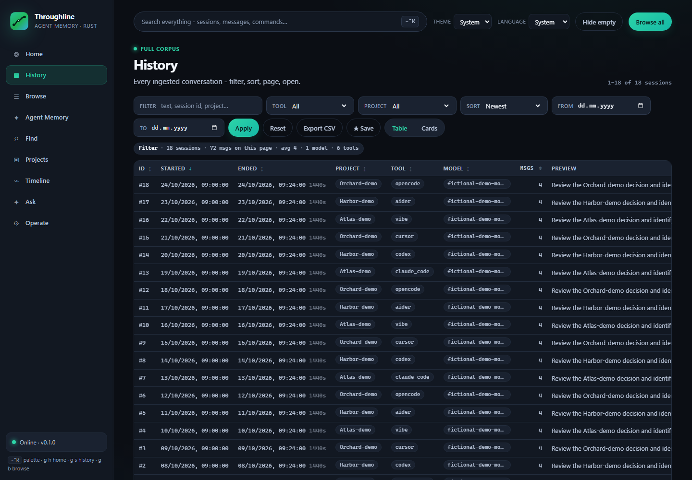

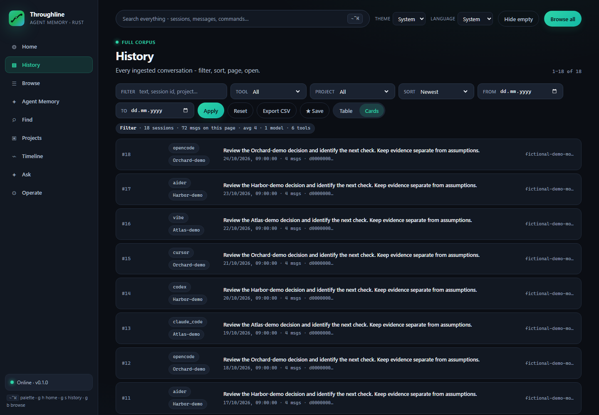

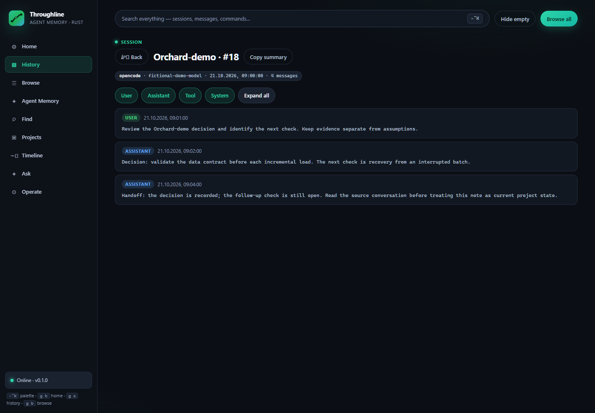

### Browse — inspect the underlying messages

Filter by text, role, tool name or conversation ID; select **Tool calls only**. A message opens full content, tool-call JSON and content blocks, with **Copy JSON** and **Open session** actions.

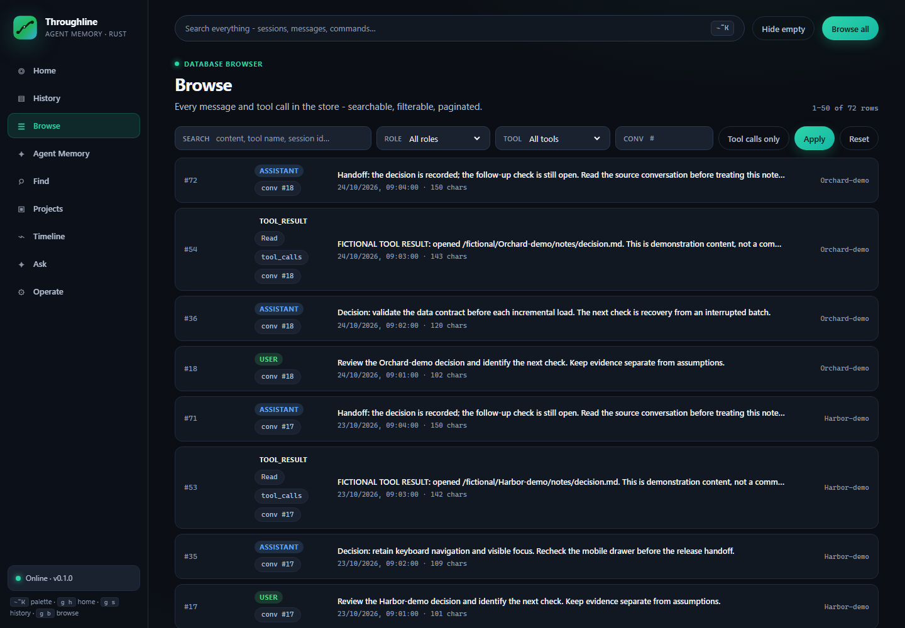

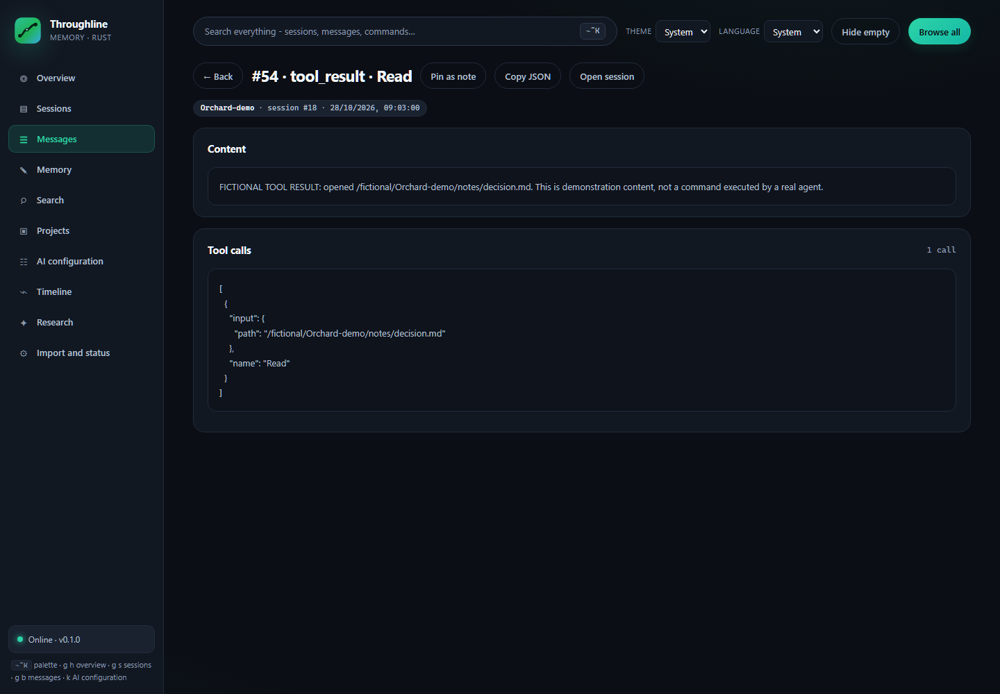

### Agent Memory — keep durable context accessible

Search notes, filter categories and expand cards. **Ingest agent memory** reads local Markdown memory files; `THROUGHLINE_AGENT_MEMORY_DIR` overrides their location. Categories include decisions, preferences, patterns, insights, error solutions, project context and workflows.

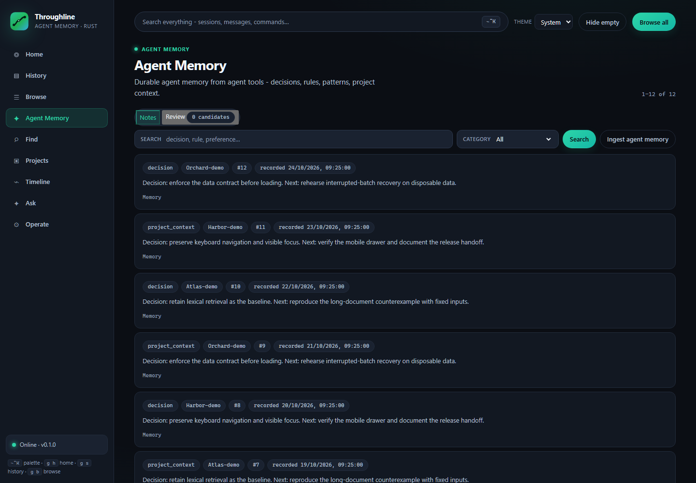

### Find — search across tools

Choose **Lexical**, **Semantic** or **Hybrid**. Lexical search needs no model; semantic search requires stored embeddings and a compatible embedding service. Results link to conversations and identify the search backend. Scores are not truth probabilities.

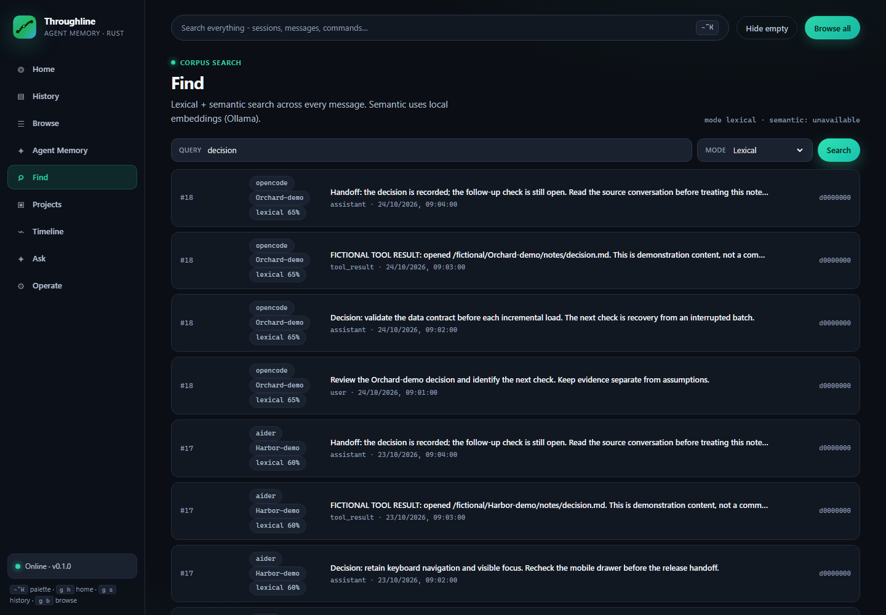

### Projects — enter through a workspace

Cards show a recorded description, status and conversation count. Select one to open its history. Recorded state is not an independent inspection of today's repository.

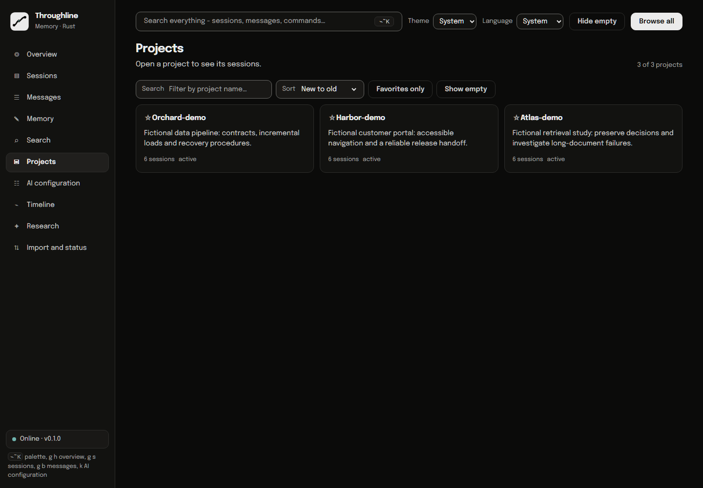

### Timeline — follow activity over time

Inspect daily conversation volume, filter by provider, switch to the calendar, navigate months or return to today. Drill into activity without confusing chronology with causality.

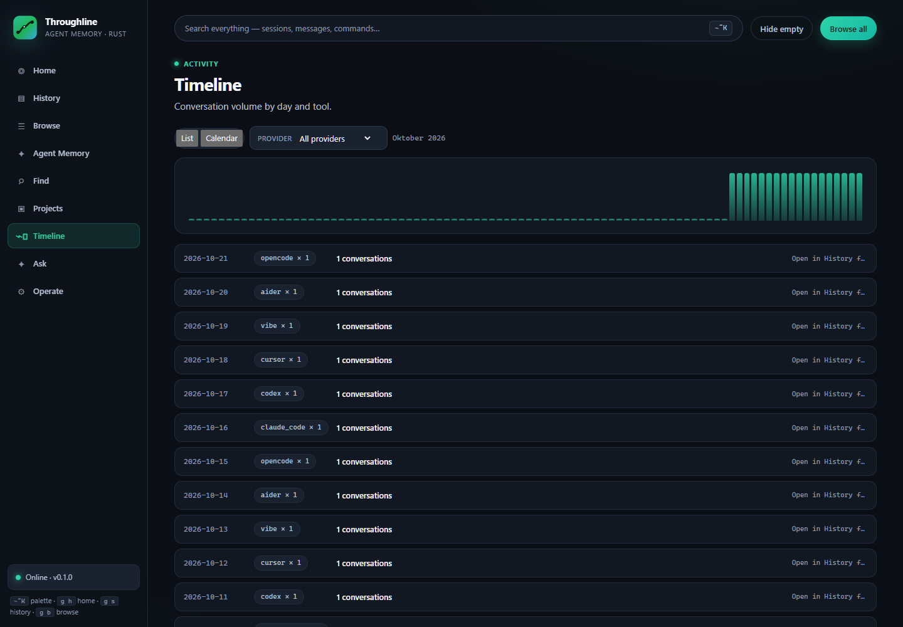

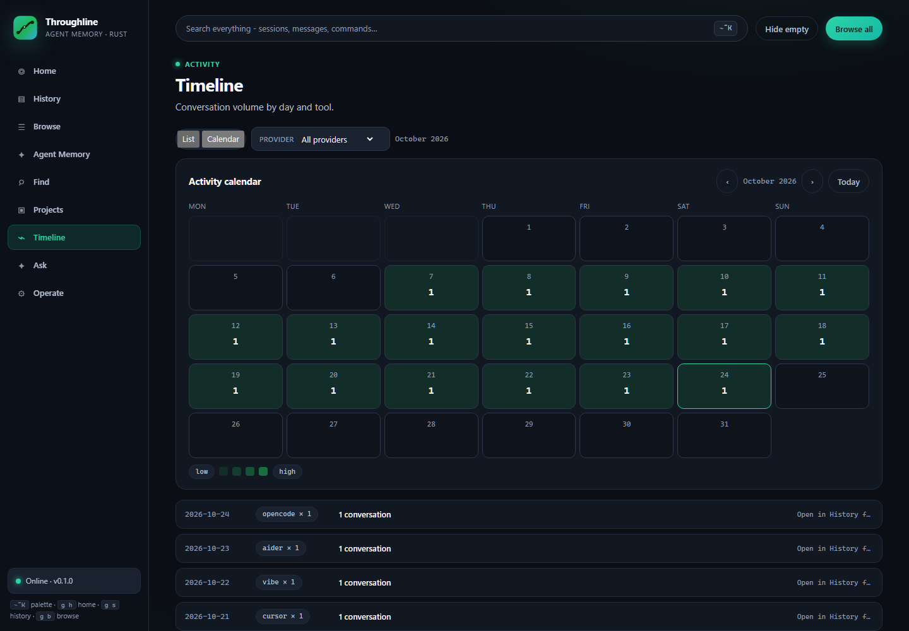

### Ask — question the recorded evidence

Enter a question and follow the returned sources. A configured generation backend is required. After backend resolution, generation failures can return excerpts; an unresolved backend can instead cause an error. This screenshot shows the input state, not an invented answer.

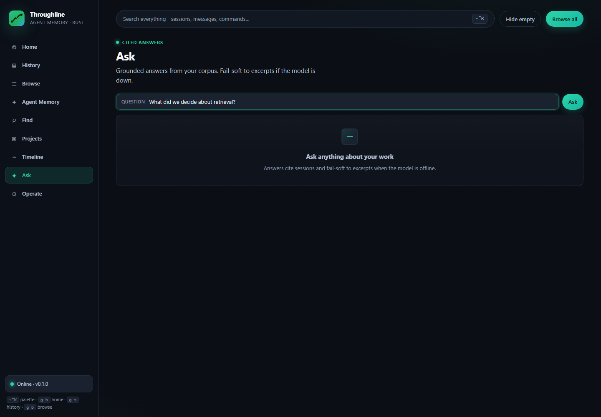

### Operate — maintain the store

Run ingestion, status, embedding, deduplication, backup, audit, stale-memory reporting, instruction-file writeback or answer evaluation. Some actions mutate data or files; model-dependent actions require configuration. See the [action reference](docs/FEATURE_GUIDE.md#maintenance-actions).

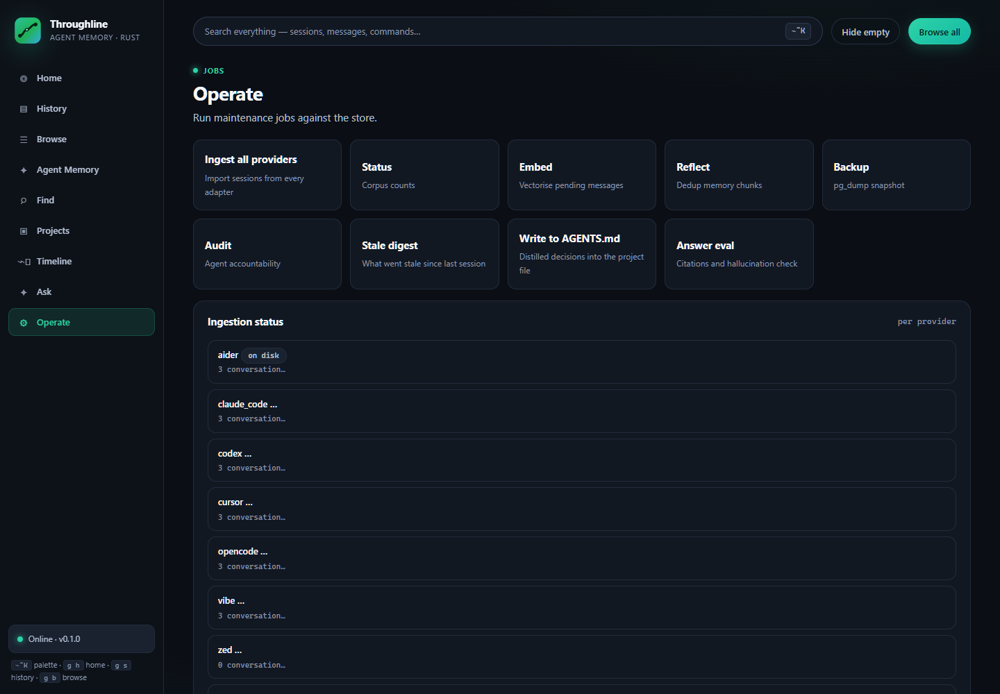

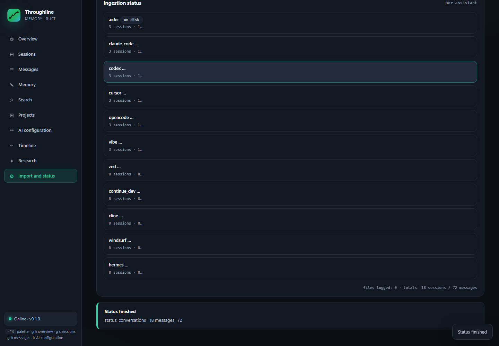

### Command palette

Use the palette to jump between views, search sessions or select an action.

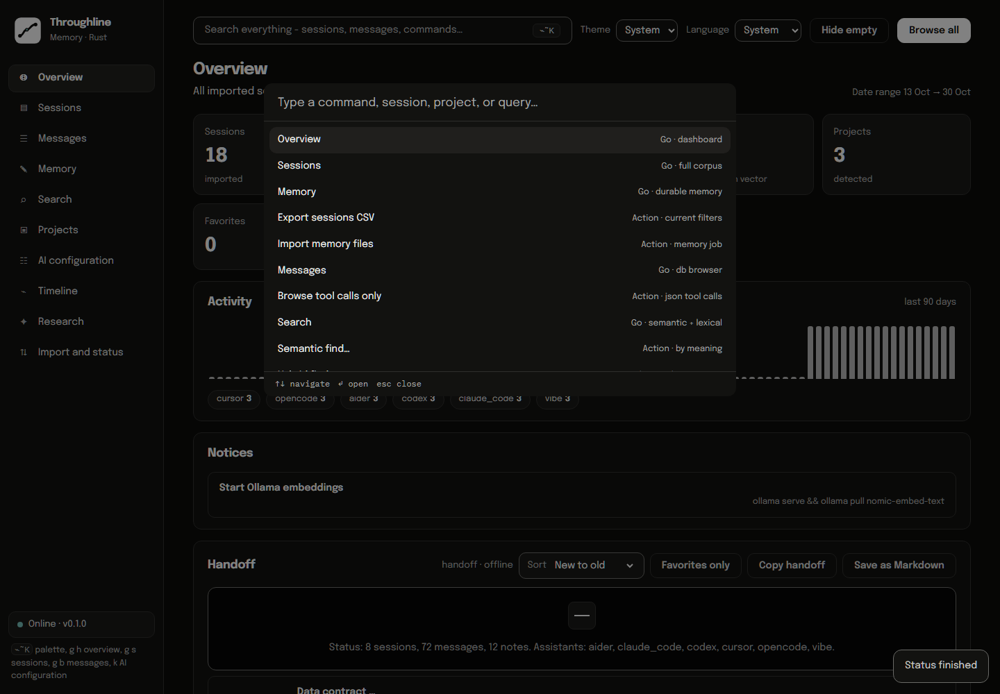

## Beyond the browser

### CLI functions

Use `throughline --help` and `throughline <command> --help` for options. In Compose, prefix commands with `docker compose exec web`.

```bash
throughline ingest --source codex
throughline search "decision" --limit 10
throughline handoff --project Atlas-demo
throughline decisions --project Atlas-demo
throughline export-markdown --out ./exports --project Atlas-demo
```

| Area | Commands |
| --- | --- |
| Setup and health | `migrate`, `serve`, `status`, `doctor` |
| Import and retrieve | `ingest`, `search`, `ask`, `handoff` |
| Enrich | `extract-memory`, `embed`, `generate-titles`, `extract-entities` |
| Inspect and maintain | `decisions`, `costs`, `audit`, `conflicts`, `reflect`, `stale-digest`, `answer-eval` |
| Carry context forward | `scan-instructions`, `writeback`, `export-markdown` |
| Protect and integrate | `backup`, `mcp` |

See the [function reference](docs/FEATURE_GUIDE.md#cli-functions) for dependencies and side effects. Availability is not a claim that every command was tested against every schema variant.

### MCP

Launch `throughline mcp` from a compatible client over stdio, with database variables in that process's environment. The container equivalent is `docker compose run -i --rm mcp`.

The Rust server advertises `search`, `list_projects`, `stats`, `write` and `forget`. **Known fresh-schema gap:** `forget` updates `memory_chunks.updated_at`, which the current Rust migration does not create. Do not rely on that action until the schema and implementation are corrected. The older Python MCP server has a different tool contract.

### Optional models

Set these in the **application process/container environment**. Compose needs an `environment` entry or override for variables it does not already forward.

| Purpose | Rust settings |
| --- | --- |
| Database | `PGHOST`, `PGPORT`, `PGDATABASE`, `PGUSER`, `PGPASSWORD` |
| Ollama endpoint | `OLLAMA_HOST`, e.g. `http://host.docker.internal:11434` on Docker Desktop |
| Embeddings | `THROUGHLINE_EMBED_BACKEND=ollama`, `OLLAMA_EMBED_MODEL=nomic-embed-text`; current path expects 768 dimensions |
| Ollama generation | `THROUGHLINE_ANSWER_BACKEND=ollama`, `THROUGHLINE_ANSWER_MODEL=<installed-model>` |
| Compatible generation | `THROUGHLINE_ANSWER_BACKEND=compatible`, `THROUGHLINE_ANSWER_BASE_URL`, `THROUGHLINE_ANSWER_MODEL`, optionally `THROUGHLINE_ANSWER_API_KEY` |
| Backup directory | `THROUGHLINE_BACKUP_DIR` or CLI `backup --dir` |

The Rust implementation supports Ollama and an explicitly configured OpenAI-compatible generation endpoint. Its named hosted OpenAI mode is disabled; embeddings use an Ollama-compatible service. A remote endpoint receives the content sent to it. See [generation](rust/crates/throughline/src/llm.rs) and [embedding](rust/crates/throughline/src/embedding.rs) configuration in the source.

## How it fits together

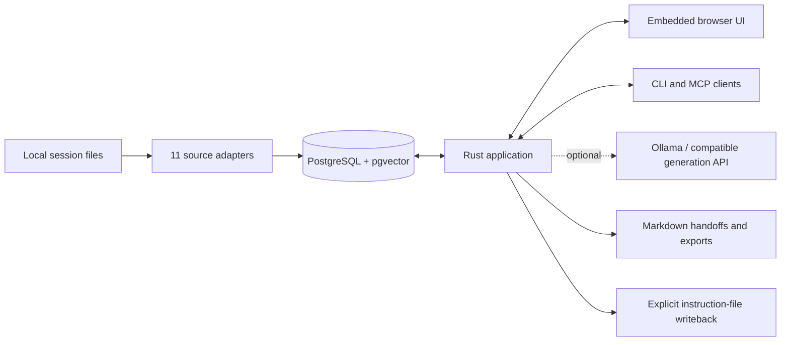

The container embeds `rust/crates/throughline/web/index.html`; Node is not required to run it. Compose applies migrations before starting the web service. Source files, the PostgreSQL store and exported Markdown remain separate artifacts.

## Current boundaries

- **Local, trusted use.** The current Rust router has no application login or role enforcement. Keep it on loopback. Older Python team-mode settings do not add authentication to this runtime.
- **Historical evidence.** Conversations, notes and answers may be incomplete, stale or wrong. Tool-call records do not prove a command succeeded or a file still exists.
- **Separate model validation.** The demo demonstrates navigation and selected deterministic actions, not model quality, vector retrieval, agent execution or backup restoration.
- **Incomplete parity.** React team operations, the 103-template library, Review, SQL Console and account management are not registered by the Rust server. Older documentation may use different commands and variables.
- **Limited evaluation.** Answer evaluation checks citations and configured phrases; its reported rate is not a general factual-accuracy measure. Entity extraction uses token heuristics.

See the [verification record](docs/demo/rust/VERIFICATION.md) for evidence and remaining gaps, and [Security](SECURITY.md) for reporting issues.

## Develop and contribute

The default runtime lives in [`rust/`](rust/). Use a toolchain compatible with its lockfile; the container pins Rust 1.90.

```bash
cargo build --release --manifest-path rust/Cargo.toml -p throughline
cargo test --manifest-path rust/Cargo.toml -p throughline --lib
```

Integration tests require a disposable PostgreSQL database with pgvector. Screenshot tooling lives under `web/`; that does not make React the default interface.

| Read next | Contents |
| --- | --- |
| [Visual feature guide](docs/FEATURE_GUIDE.md) | All current menus, detail views, maintenance actions and CLI functions. |
| [Rust demo guide](docs/demo/rust/README.md) | Isolated fixture, screenshot regeneration and cleanup. |
| [Verification record](docs/demo/rust/VERIFICATION.md) | What was checked and what remains unverified. |
| [Contributing](CONTRIBUTING.md) | Contribution conventions; distinguish Rust work from Python/React checks. |
| [Changelog](CHANGELOG.md) | Recorded project changes. |
| [Earlier Python/React demo](docs/DEMO.md) | The previous application's fixture and recordings. |

Report reproducible bugs through [GitHub Issues](https://github.com/mkupermann/throughline/issues). Contributions follow the [Code of Conduct](CODE_OF_CONDUCT.md).

## License

[MIT](LICENSE). Self-host it, inspect it and adapt it to your workflow.
