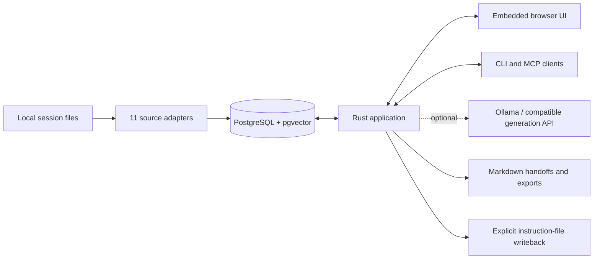

<p align="center">
  <picture>
    <source media="(prefers-color-scheme: dark)" srcset="docs/brand/throughline-wordmark-dark.svg">
    
  </picture>
</p>

<p align="center"><strong>Your tools change. Your project context should not disappear.</strong></p>
<p align="center">A self-hosted memory layer for AI coding sessions. Rust core, PostgreSQL store, your machine.</p>

<p align="center">
  <a href="https://github.com/mkupermann/throughline/actions/workflows/ci.yml"></a>
  <a href="LICENSE"></a>
  <a href="rust/Cargo.toml"></a>
  <a href="sql/schema.sql"></a>
  <a href="CHANGELOG.md"></a>
</p>

<p align="center"><strong>English</strong> · <a href="README.de.md">Deutsch</a></p>

Every AI coding tool keeps its own session files and forgets the rest. Decisions disappear into transcripts. Fixes get rediscovered. Context gets explained again. Throughline imports those local sessions into one searchable PostgreSQL history. You recover a decision, inspect the original messages and tool calls, and carry a source-linked handoff into the next session. Even when you switch tools.

**Import. Inspect. Remember. Continue.** Browsing, keyword search and handoff briefs work without any model. Optional local models add embeddings, memory extraction and cited answers.

[Try the demo](#try-it-with-fictional-data) · [Install](#use-your-own-sessions) · [Product tour](#the-product-tour) · [CLI and MCP](#beyond-the-browser) · [Architecture](#how-it-fits-together) · [Limits](#current-boundaries)

[](docs/media/rust/tour.mp4)

*Actual application, fictional data, no mocked responses. [Watch the full tour (MP4)](docs/media/rust/tour.mp4) · [capture manifest](docs/media/rust/manifest.json).*

> **Which version is this?** Default Docker Compose builds the Rust application with its embedded browser interface. The repository also contains an earlier Python/FastAPI + React application. Its AI team operations, template library and account screens are not features of the Rust UI. This README documents the default Rust path.

## Why use Throughline?

| When you need to… | Throughline gives you… |
| --- | --- |
| Resume a project after time away | Recent sessions, durable notes and an offline handoff brief. |
| Understand why a decision was made | Search results connected to the original conversation. |
| Move between coding tools | A shared store, Markdown export and MCP access. |
| Inspect what an agent recorded | Message content, tool-call JSON, timestamps and source-tool labels. |
| Maintain accumulated context | Memory categories, deduplication, stale-memory reports and explicit writeback. |

### Supported session sources

The Rust registry includes **11 adapters**: Claude Code, Codex, Cursor, Zed, Continue, Cline, Windsurf, Vibe, Hermes, OpenCode and Aider. They read supported local files. They are not cloud-account sync integrations, and format coverage varies by tool.

Standard Compose mounts the first nine tool directories read-only. OpenCode and Aider need their source directories mounted separately. The source of truth is the [adapter registry](rust/crates/throughline/src/adapters/registry.rs).

## Try it with fictional data

Three commands. No model download, no API key. You need Git and Docker with Compose.

```bash
git clone https://github.com/mkupermann/throughline.git
cd throughline
docker compose -f docs/demo/rust/compose.yml up -d --build
```

Open **[http://127.0.0.1:8796](http://127.0.0.1:8796)**.

The demo has its own database and volume. It exposes only the web port on loopback and mounts no personal session folders. Its public password exists only for this disposable stack. Model endpoints deliberately point to an unavailable loopback address.

| Demo project | Story to explore |
| --- | --- |
| **Atlas-demo** | Retain lexical retrieval as a baseline. Investigate a long-document counterexample. |
| **Harbor-demo** | Preserve keyboard navigation and visible focus. Prepare a release handoff. |
| **Orchard-demo** | Validate data contracts. Rehearse recovery from an interrupted load. |

The fixture contains **18 conversations, 72 messages, 12 memory notes and three projects** across six source-tool labels. Decisions, tool results and model names are invented. Dates are rebased on seed. This is not benchmark evidence and not completed agent work.

1. Open **Projects → Atlas-demo**, then open a conversation and expand its messages.
2. Inspect the fictional `Read` tool result through **Browse**.
3. In **Find**, select **Lexical** and search for `decision`.
4. In **Agent Memory**, filter the `decision` category.
5. Switch **Timeline** to **Calendar**, then return **Home** for the handoff.
6. Open **Operate → Status** to check the corpus totals.

Stop with `docker compose -f docs/demo/rust/compose.yml stop`. The [demo guide](docs/demo/rust/README.md) covers reseeding, screenshots and cleanup.

## Use your own sessions

You need Git, Python 3 for the environment initializer, and Docker with Compose. The application itself runs as Rust inside the container.

```bash
git clone https://github.com/mkupermann/throughline.git
cd throughline
python3 scripts/init_compose_env.py --check-docker
docker compose up -d --build
docker compose exec web throughline ingest --source all
docker compose exec web throughline doctor
```

Open **[http://127.0.0.1:8788](http://127.0.0.1:8788)**. On Windows, use `py -3` if `python3` is unavailable.

The initializer creates an ignored `.env` with a random database password and resolves the Cline mount. Review [docker-compose.yml](docker-compose.yml) for the source locations. Import is explicit. Unchanged file hashes are skipped on the next run. A new `.env` does not rotate credentials in an existing database volume.

### Back up, update and export

Always back up into the mounted backup volume with an explicit destination:

```bash
docker compose exec web throughline backup --dir /var/lib/throughline/backups
git pull
docker compose build web migrate
docker compose up -d migrate web
docker compose exec web throughline doctor
```

Rust reads `THROUGHLINE_BACKUP_DIR`, not the older `CLAUDE_MEMORY_BACKUP_DIR` variable still present in Compose. The explicit `--dir` keeps the backup out of the container's disposable layer. Keep off-host copies and verify restoration.

```bash
docker compose exec web throughline export-markdown --out /home/throughline/exports
```

Exports land in the mounted `./exports` unless you change `THROUGHLINE_EXPORT_DIR`. Options include `--project`, `--include-generated` and `--redact`. Inspect an export before sharing it. Redaction reduces exposure, it does not guarantee anonymization.

**`docker compose down -v` deletes the data volumes. Never run it on a real installation unless that deletion is intended.**

## The product tour

All nine menus and their supporting views are shown below, captured from the running demo. The [visual feature guide](docs/FEATURE_GUIDE.md) covers alternate views, detail screens, every maintenance action and the CLI.

| Menu | Purpose | Chord |
| --- | --- | --- |
| Home | Totals, activity, recovery hints, handoff and recent sessions. | `g h` |
| History | Filter, sort, page and export conversations. | `g s` |
| Browse | Search messages and tool calls. | `g b` |
| Agent Memory | Inspect durable notes by category. | `g m` |
| Find | Lexical, semantic and hybrid search. | `g f` |
| Projects | Open a workspace's filtered history. | `g j` |
| Timeline | Activity by date and source tool. | `g t` |
| Ask | Answers with source references. | `g a` |
| Operate | Maintenance and ingestion status. | `g p` |

Press `Ctrl+K` / `Cmd+K` for the command palette. A chord means press `g`, then the second key.

### Home. Recover the thread

Click a metric to drill into the corpus. Inspect activity, recent sessions and the offline continuation brief. **Hide empty** cleans the session listing, **Browse all** opens the messages. The model-free demo visibly reports missing Ollama in its recovery hints. Nothing is hidden.


### History. Conversations in context

Filter by text, tool, project and date. Sort, switch between table and cards, save filters, page through records or export CSV. Open a session to read its messages with their roles.


### Browse. Inspect the underlying messages

Filter by text, role, tool name or conversation ID, or select **Tool calls only**. A message opens its full content, tool-call JSON and content blocks, with **Copy JSON** and **Open session** actions.


### Agent Memory. Keep durable context accessible

Search notes, filter categories and expand cards. **Ingest agent memory** reads local Markdown memory files. `THROUGHLINE_AGENT_MEMORY_DIR` selects their location. Categories cover decisions, preferences, patterns, insights, error solutions, project context and workflows.


### Find. Search across tools

Choose **Lexical**, **Semantic** or **Hybrid**. Lexical search needs no model. Semantic search requires stored embeddings and a compatible embedding service. Results link to conversations and name the search backend. Scores are retrieval values, not truth probabilities.


### Projects. Enter through a workspace

Cards show a recorded description, status and conversation count. Select one to open its history. Recorded state is history, not an inspection of today's repository.


### Timeline. Follow activity over time

Inspect daily conversation volume, filter by provider, switch to the calendar, navigate months or jump back to today. Chronology is not causality, and the view keeps that distinction visible.


### Ask. Question the recorded evidence

Enter a question and follow the returned sources. A configured generation backend is required. After backend resolution, a generation failure can still return excerpts. An unresolved backend returns an error instead. The screenshot shows the input state, not an invented answer.


### Operate. Maintain the store

Run ingestion, status, embedding, deduplication, backup, audit, stale-memory reporting, instruction-file writeback or answer evaluation. Some actions mutate data or files, and model-dependent actions need configuration first. See the [action reference](docs/FEATURE_GUIDE.md#maintenance-actions).


### Command palette

Jump between views, search sessions or pick an action without leaving the keyboard.


## Beyond the browser

### CLI functions

Use `throughline --help` and `throughline <command> --help` for options. In Compose, prefix commands with `docker compose exec web`.

```bash
throughline ingest --source codex
throughline search "decision" --limit 10
throughline handoff --project Atlas-demo
throughline decisions --project Atlas-demo
throughline export-markdown --out ./exports --project Atlas-demo --evidence
```

| Area | Commands |
| --- | --- |
| Setup and health | `migrate`, `serve`, `status`, `doctor` |
| Import and retrieve | `ingest`, `search`, `ask`, `handoff` |
| Enrich | `extract-memory`, `embed`, `generate-titles`, `extract-entities` |
| Inspect and maintain | `decisions`, `costs`, `audit`, `conflicts`, `reflect`, `stale-digest`, `answer-eval` |
| Carry context forward | `scan-instructions`, `writeback`, `export-markdown` |
| Protect and integrate | `backup`, `mcp` |

The [function reference](docs/FEATURE_GUIDE.md#cli-functions) lists dependencies and side effects. Availability is not a claim that every command was tested against every schema variant.

### MCP

Launch `throughline mcp` from a compatible client over stdio, with the database variables in that process's environment. The container equivalent is `docker compose run -i --rm mcp`.

The Rust server advertises `search`, `list_projects`, `stats`, `write` and `forget`. All five actions run against a fresh schema. The older Python MCP server has a different tool contract.

### Optional models

Set these in the application container's environment. Compose needs an `environment` entry or an override file for variables it does not already forward.

The demo ships a ready-made overlay. One command starts a local Ollama, pulls `nomic-embed-text` plus a small instruct model, and switches the demo to live semantic search and Ask:

```bash
docker compose -f docs/demo/rust/compose.yml -f docs/demo/rust/compose.models.yml up -d --build
```

Without the second file the demo stays model-free. Nothing leaves your machine either way.

| Purpose | Rust settings |
| --- | --- |
| Database | `PGHOST`, `PGPORT`, `PGDATABASE`, `PGUSER`, `PGPASSWORD` |
| Ollama endpoint | `OLLAMA_HOST`, e.g. `http://host.docker.internal:11434` on Docker Desktop |
| Embeddings | `THROUGHLINE_EMBED_BACKEND=ollama`, `OLLAMA_EMBED_MODEL=nomic-embed-text` (current path expects 768 dimensions) |
| Ollama generation | `THROUGHLINE_ANSWER_BACKEND=ollama`, `THROUGHLINE_ANSWER_MODEL=<installed-model>` |
| Compatible generation | `THROUGHLINE_ANSWER_BACKEND=compatible`, `THROUGHLINE_ANSWER_BASE_URL`, `THROUGHLINE_ANSWER_MODEL`, optionally `THROUGHLINE_ANSWER_API_KEY` |
| Backup directory | `THROUGHLINE_BACKUP_DIR` or CLI `backup --dir` |

The Rust implementation supports Ollama and an explicitly configured OpenAI-compatible generation endpoint. Hosted OpenAI as a named mode is disabled, and embeddings go through an Ollama-compatible service. A remote endpoint receives whatever content is sent to it. Details live in the [generation](rust/crates/throughline/src/llm.rs) and [embedding](rust/crates/throughline/src/embedding.rs) sources.

## How it fits together



The container embeds `rust/crates/throughline/web/index.html`. Node is not required to run it. Compose applies migrations before starting the web service. Source files, the PostgreSQL store and exported Markdown stay separate artifacts.

## Traceability by design

Regulators, auditors and research institutions are converging on the same demand: AI-assisted work must be reconstructable after the fact. Throughline records AI coding work in exactly the shape those frameworks describe. That is a design statement, not a compliance certification.

| Requirement | Source | What Throughline stores |
| --- | --- | --- |
| Automatic recording of events over the system's lifetime, for traceability | [EU AI Act, Art. 12(1) and 12(2)](https://ai-act-service-desk.ec.europa.eu/en/ai-act/article-12), Regulation (EU) 2024/1689 | Every imported session is recorded automatically with timestamps, source tool and model label. No manual bookkeeping. |
| Log retention of at least six months by the deployer | [EU AI Act, Art. 19 and Art. 26(6)](https://artificialintelligenceact.eu/article/19/) | The corpus lives in your PostgreSQL volume for as long as you keep it, with `backup` and restore as explicit commands. Deletion is a deliberate act. |
| A reviewer must see which model was used, how it was prompted and how the output was validated | [World Bank AI reproducibility guidelines](https://worldbank.github.io/wb-reproducible-research-repository/guidance/AI_reproducibility_guidelines.html) | Per message: model label, full prompt and response text, role, timestamps. Per answer in Ask: the cited source records. |
| Per-interaction logs of timestamps, model version, prompts, tool calls and outputs for agent-assisted research | [Logging schema proposed in arXiv:2604.00945](https://arxiv.org/pdf/2604.00945) | The message record carries exactly these fields, including tool-call JSON and content blocks, inspectable in Browse. |
| An evidence package that can be verified independently of the system that produced it | [World Bank AI reproducibility guidelines](https://worldbank.github.io/wb-reproducible-research-repository/guidance/AI_reproducibility_guidelines.html), [arXiv:2604.00945](https://arxiv.org/pdf/2604.00945) | `export-markdown --evidence` ships a provenance manifest with the export: per conversation the model, source tool and time range, per file a SHA-256 hash and size, plus corpus totals. Deterministic except for the generation timestamp. |
| Standardized trace attributes for GenAI operations | [OpenTelemetry GenAI semantic conventions](https://opentelemetry.io/docs/specs/semconv/gen-ai/) | The stored fields map onto these conventions. A native OTel export is on the roadmap, not shipped. |

Two honest limits. First, Throughline records what the source tools wrote to disk, so completeness depends on their session formats. Second, whether any concrete system falls under the AI Act is a legal question about that system. This software does not answer it and does not claim high-risk conformity for anything. What it gives you is the raw material every one of these frameworks asks for: the original evidence, kept locally, searchable, with its context intact.

Public administrations pushing for digital sovereignty, such as the [Franco-German initiative for an open-source administrative workplace](https://www.dbb.de/artikel-dbb-europathemen/silberbach-begruesst-deutsch-franzoesische-initiative.html), name the same properties this project is built on: open source, local operation, no vendor lock-in.

## Current boundaries

Honest limits beat silent surprises. These are the current ones.

- **Local, trusted use.** The Rust router has no application login or role enforcement. Keep it on loopback. Older Python team-mode settings do not add authentication to this runtime.
- **Historical evidence.** Conversations, notes and answers can be incomplete, stale or wrong. A tool-call record does not prove a command succeeded or a file still exists.
- **Separate model validation.** The demo demonstrates navigation and selected deterministic actions, not model quality, vector retrieval, agent execution or backup restoration.
- **Incomplete parity.** React team operations, the template library, Review, SQL Console and account management are not registered by the Rust server. Older documentation may use different commands and variables.
- **Limited evaluation.** Answer evaluation checks citations and configured phrases. Its reported rate is not a general factual-accuracy measure. Entity extraction uses token heuristics.

The [verification record](docs/demo/rust/VERIFICATION.md) lists the evidence and the remaining gaps. Security issues go through [Security](SECURITY.md).

## Develop and contribute

The default runtime lives in [`rust/`](rust/). Use a toolchain compatible with its lockfile. The container pins Rust 1.90.

```bash
cargo build --release --manifest-path rust/Cargo.toml -p throughline
cargo test --manifest-path rust/Cargo.toml -p throughline --lib
```

Integration tests need a disposable PostgreSQL database with pgvector. Screenshot and recording tooling lives under `web/`. That does not make React the default interface.

| Read next | Contents |
| --- | --- |
| [Visual feature guide](docs/FEATURE_GUIDE.md) | All menus, detail views, maintenance actions and CLI functions. |
| [Rust demo guide](docs/demo/rust/README.md) | Isolated fixture, screenshot regeneration and cleanup. |
| [Verification record](docs/demo/rust/VERIFICATION.md) | What was checked and what remains unverified. |
| [Contributing](CONTRIBUTING.md) | Conventions, and how Rust work differs from Python/React checks. |
| [Changelog](CHANGELOG.md) | Recorded project changes. |
| [Earlier Python/React demo](docs/DEMO.md) | The previous application's fixture and recordings. |

Report reproducible bugs through [GitHub Issues](https://github.com/mkupermann/throughline/issues). Contributions follow the [Code of Conduct](CODE_OF_CONDUCT.md).

## License

[MIT](LICENSE). Self-host it, inspect it, adapt it.

Your AI work should compound. Not evaporate.
