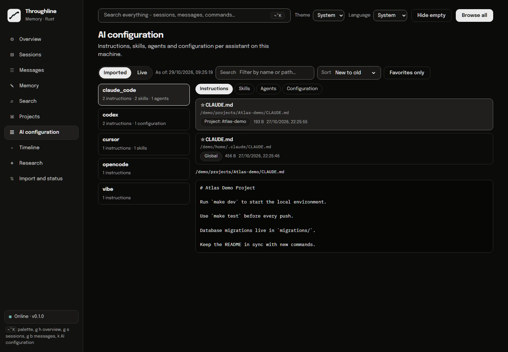

# Throughline visual feature guide

[README](../README.md) · [Run this demo](demo/rust/README.md) · [Verification](demo/rust/VERIFICATION.md)

This reference describes the default Rust application. Screenshots use invented Atlas, Harbor and Orchard projects. Source of truth: [embedded UI](../rust/crates/throughline/web/index.html), [HTTP handlers](../rust/crates/throughline/src/server.rs), [CLI](../rust/crates/throughline/src/main.rs) and [MCP](../rust/crates/throughline/src/mcp.rs).

## Navigation and shared controls

The left navigation contains Overview, Sessions, Messages, Search, Memory, Projects, AI configuration, Timeline, Research and Import and status. `Ctrl+K` / `Cmd+K` opens the palette; `?` also opens it outside text inputs. Use arrow keys and Enter to choose an item, Escape to close. Palette search combines commands and corpus navigation.

| Control | Behavior |
| --- | --- |
| Search everything | Opens the palette. |
| Browse all | Opens individual messages and tool calls. |
| Hide empty | Toggles empty-session visibility. |
| Health indicator | Reports current database connectivity/version; not a backup or model-quality check. |
| `g` followed by `h/s/b/m/f/j/k/t/a/p` | Overview / Sessions / Messages / Memory / Search / Projects / AI configuration / Timeline / Research / Import and status. |

## Overview

Counts for conversations, messages, memory, vectors and projects link to the relevant surface. Activity covers recent days; source labels identify tools. Recovery hints reflect runtime configuration. The offline handoff contains recorded context, not a fresh inspection of files or task completion.

## Sessions

Text, tool, project and date filters narrow the corpus. Apply/Reset control the query; newest, oldest and most-messages ordering are available. Column headers also expose sorting. Table/Cards changes presentation, Save stores a browser-side filter, Export CSV downloads up to 50,000 matching conversations, and Previous/Next page through sessions. CSV is not a database backup.

Open a session to inspect its message sequence. Role toggles filter the displayed messages. Expand all reveals collapsed content; Copy summary copies the session summary, and Back returns to the previous view. Recorded tool output is evidence of what was stored, not independent evidence that the operation succeeded.

## Messages and message details

Search content, tool names or session IDs. Filter role, exact tool name, conversation number or tool-carrying messages; Apply/Reset and paging control results.

Message detail shows full content and available structured tool calls/content blocks. Copy JSON exports that record; Open session returns to its conversation. The fixture's tool result explicitly identifies itself as fictional.

## Memory

Search durable notes, filter category, page results and expand individual cards. The categories are decision, preference, pattern, insight, error_solution, project_context and workflow. Ingest agent memory scans configured Markdown files and upserts notes tagged `agent-memory`. Set `THROUGHLINE_AGENT_MEMORY_DIR` to select that source tree. This action changes the database; it is not a read-only refresh.

Each card shows when the note became valid ("valid since") and, once something replaced it, when it stopped ("valid until"). The source chip reads "source from" when the conversation date is known. The "As of" filter takes a date and a choice: "was valid" lists the notes that held on that day, "was known" lists what Throughline had recorded by then. While a date is set, the status filter is disabled. The replace dialog has two more fields. "Valid from" is the start of the new note and stays empty for today. The choice between Update and Correction says whether the old note was right until then or never right. A start date in the future is refused and the dialog stays open.

The "By meaning" toggle (German: "Nach Bedeutung") searches notes by meaning instead of by words, through `recall`. It uses the current notes of the selected project. Without embeddings from Ollama the view shows a notice that the answer is based on words only.

## Search

Lexical mode matches text without generation. Semantic mode needs an embedding backend and indexed records; Hybrid combines available search paths. Results retain session/project/tool context and open the conversation. Backend status remains visible. Ranking scores are retrieval values, not factual confidence.

## Projects

Each recorded project exposes its description, status and session count. Click it to enter its filtered Sessions. These are historical projects, not the earlier React application's Operations projects or team resources.

## AI configuration

One list per assistant of the instruction files, skills, agents and configuration files found on this machine, global and per project. Tabs switch between the four kinds, the search box filters by name and path, the sort control offers new to old, old to new and name. A click opens the file as plain text. Secret values are masked on the server and the browser never names a path. The default source is the imported copy (table assistant_configs, refreshed by every ingest and by the job "Import AI configuration") with an "As of" line; "Live" reads from disk.

## Timeline

List/chart mode shows daily conversation volume by source. Provider filtering narrows activity; selecting activity drills into history. Calendar supports previous/next month and Today. Counts describe recorded conversations, not productivity or cost.

## Research

Submit a question to retrieve evidence and request generation. Open cited sessions to inspect the underlying records. When backend resolution succeeds but generation fails, the implementation can return retrieved excerpts. Backend-resolution failures can return an error before that fallback. No model request was made for this screenshot.

## Maintenance actions

| Action | What it does | Dependency or side effect |
| --- | --- | --- |
| Ingest all providers | Runs registered adapters. | Reads available local source files; writes imported records. |
| Status | Reports conversation and message counts. | Database read; demonstrated below. |
| Embed | Vectorizes pending messages. | Calls the embedding service and writes vectors; UI batch is bounded. |
| Reflect | Deduplicates memory chunks. | Changes memory state; the UI action is not every CLI reflection mode. |
| Backup | Runs `pg_dump` and retains recent dumps. | Writes files and prunes old dumps; configure a persistent backup directory. |
| Audit | Reports recorded agent/MCP activity. | A summary of available records, not a tamper-proof security audit. |
| Stale digest | Reports stale/superseded/unused memory candidates. | Heuristics need human review. |
| Write to AGENTS.md | Writes distilled memory into an instruction file. | Filesystem mutation; use CLI `--root` for an explicit destination. |
| Answer eval | Runs configured/default answer checks. | May call a model; citation/phrase checks do not certify truth. |

The provider status panel is a separate view of discovery/import state. The demo intentionally has no real session folders mounted. Its seeded conversations were not ingested through adapters.

## CLI functions

All 24 commands exposed by the Rust CLI are listed below. Use `<command> --help` for exact options; the older Python CLI differs.

| Command | Function and relevant boundary |
| --- | --- |
| `migrate` | Apply Rust schema migrations; `--status` reports the ledger. |
| `serve` | Start the embedded UI/API; defaults to loopback port 8787. |
| `status` | Report conversation/message counts. |
| `doctor` | Inspect database and model/backend availability. |
| `ingest` | Import `--source all` or a named adapter. |
| `search` | Keyword search; optional `--semantic` and `--from` selection. |
| `ask` | Retrieve records and generate a cited answer, with conditional excerpt fallback. |
| `handoff` | Build an offline continuation brief, optionally scoped to a project. |
| `extract-memory` | Extract durable notes from messages not yet extracted, newest conversations first, in bounded windows using generation. |
| `embed` | Generate missing message embeddings through the configured service. |
| `generate-titles` | Generate titles for conversations that lack them. |
| `extract-entities` | Harvest entity-like tokens from active memory using heuristics. |
| `decisions` | List recorded decisions, provenance and supersession. |
| `costs` | Summarize recorded usage/cost data; missing source data is not a verified zero bill. |
| `audit` | Summarize recorded self-actions and MCP writes. |
| `conflicts` | Find candidate memory conflicts for review. |
| `reflect` | Run memory maintenance modes; inspect `--dry-run` where applicable. |
| `stale-digest` | Report memory requiring renewed attention. |
| `answer-eval` | Evaluate supplied/default cases with citation and phrase checks. |
| `scan-instructions` | Index local project instruction files into the store. |
| `writeback` | Write distilled notes into project instructions; select `--root` deliberately. Without `--project` only notes of the project named like the `--root` folder are written. |
| `export-markdown` | Write a Markdown vault; supports project selection and optional redaction. `--evidence` adds a provenance manifest with model, source tool, time range and SHA-256 per exported file. |
| `backup` | Dump the database to a directory and keep the newest `--keep` dumps. Rotation only touches its own `<database>-YYYYMMDD-HHMMSS.sql` files. |
| `mcp` | Serve the Rust MCP tool contract over stdio. |

Not all commands have a corresponding browser button. No screenshot can demonstrate the success of an unexecuted CLI command. See the verification record for tested paths.

## Earlier application

The Python/React code retains Projects/Conversations, Review, Console, AI settings, workspace accounts and AI team/template management. Its [template guide](TEMPLATES.md) and [recordings](videos/README.md) describe that implementation. They are not demonstrations of routes served by `Dockerfile.rust`.
